# Architecture and decisions (Codex continuation)

```mermaid
flowchart LR
  I[Markdown / dictionary / CSV or Point GeoJSON] --> S[Immutable project input]
  S --> D[Manual baseline or compatible LLM draft]
  D --> Q[Quote / schema / coverage checks]
  Q --> H[Human review + revision check]
  H --> A[Approved rule snapshot]
  A --> K[Existing deterministic spatial kernel]
  K --> E[Three-state results + JSON / HTML evidence]
  E --> C[Corrected batch with same ruler]
  C --> R[Entity / rule / artifact comparison]
```

The new layer does not duplicate the verdict engine. It adds persisted projects, bounded async jobs, version-checked review, immutable validation runs and local presentation. SQLite transactions serialize metadata changes; files are stored below work/app. On restart queued/running jobs are marked INTERRUPTED and require explicit resubmission. No task is silently treated as completed.

Single-agent live extraction is implemented as a JSON proposal call. A fixed workflow validates and asks a human to approve. Multi-agent was not added because there is no live baseline with which to establish benefit. The report layer is deterministic and cannot change verdicts.

The manual authoring baseline recognizes a deliberately limited set of explicit Chinese requirement patterns. It is reproducible, cheap and useful as a reference. It is not an LLM and is not robust arbitrary-document understanding. Omitted detectable requirement lines are preserved as unknown. Automated coverage detection itself is heuristic; human review remains required, especially for unnumbered prose.

Current engine uses canonical rule IDs R01–R10 and one instance per rule type. Conflicting same-type requirements remain a clarification instead of silently overwriting the first. Arbitrary field names are not silently remapped. Point GeoJSON is normalized into canonical CSV with explicit EPSG:4326 declaration; original source file is retained.

The application binds to loopback by default, limits upload and queue size, rejects cross-origin/Host mismatches and requires a per-process CSRF token for writes. These do not provide authentication, encryption, tamper-proof audit or multi-tenant isolation. Each deployment must retain that boundary.

Budget records distinguish unknown usage from zero. No original POI records are sent to a model. Failed provider calls store sanitized metadata only. Mock transport tests verify retry/budget behavior but are not AI performance evidence.

## Single-owner persistence

A data directory has one application owner at a time, enforced by an OS file lock. Close the app before starting a second server or CLI process against the same directory. Separate data directories may be used independently. Tests of restart behavior release the first owner before constructing the second.

Local inference option: the same proposal/review workflow can now target Ollama on loopback. The local launcher strips cloud credentials, disables Ollama cloud features, runs one model at a time and uses a distinct work/local-app workspace on port 8766. No agent or report layer gets approval authority. Runtime installation and model quality are separately evidenced.

## Local model quality boundary

Local generation uses candidate source lines and JSON Schema constraints as a compiler boundary. Structural fields cannot carry invented parameter-source records; decision parameters must carry the prescribed source count and allowed unit vocabulary. Required boolean conditions remain model choices, not silently repaired values. Quotes, parameter lineage, data types, configuration and final approval remain separate gates.

The quality harness dry-validates the existing source contracts without authorizing any approval. It also checks explicit semantic conditions on synthetic cases: passing the configuration validator is insufficient when, for example, whitespace trimming is disabled despite the source requiring it. The detailed report separates malformed/guard-rejected drafts, semantic failures and per-check outcomes. Same-template prompt tuning is labelled developer regression, with preserved original outputs and prompt/source digests; it is not presented as a held-out experiment.

## Evidence-only local generation

The local model emits typed parameters and a parameter_evidence object keyed by the rule's required decision parameters. It selects original spans/interpretations; it no longer duplicates the parameter value, unit and numeric literal in a second record. The compiler copies the actual model parameter, derives the standard unit/literal representation, verifies literal presence and bound quotes, and checks typed rule contracts. Unresolved references, invalid types and ungrounded values quarantine that rule and keep the affected clauses NEEDS_CLARIFICATION. No correct answer or manual-baseline rule is substituted.

Normalized drafts remain DRAFT, retain the original model_proposal, compiler quarantine reasons and call metadata. Production and quality evaluation invoke this same compiler. The fourth real local regression passed 12/12; a separate pre-frozen developer-labelled 80-clause set reached 75/80 compiled mappings with all unknown cases retained and no lineage errors. Neither is independent human validation.

Local HTTP requests explicitly bypass proxy environment settings. Server startup now reports loopback permission denial directly after a sandbox reset. API keys remain excluded from the local profile. Actual user-requested in-app-browser exports were saved and verified against server bytes, closing the local attachment-save gate separately from the still permission-blocked sandbox Chromium engine.
