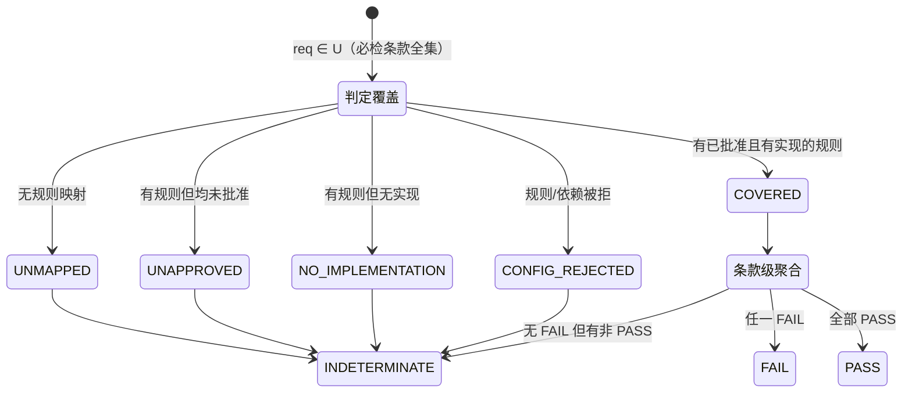

# Stage 0 重验：契约统一设计

- 版本：v1.0（2026-10-26）
- 作者：高见远（架构师）
- 依据：`GeoAcceptance-Stage0-独立验收报告.md`（结论：不通过）+ 独立探针 `stage0_independent_probes.py` + 探针结果 `stage0-independent-results.json`
- 范围：GA-01 ~ GA-10 以及验收方提出的"自检证据限制"六条
- 地位：**本文件是 Stage 0 重验的契约唯一来源**。实现与本文件冲突时，以实现"未声明差异"为缺陷；本文件与 `docs/three-state-verdict.md` / `docs/rule-semantics.md` / `docs/data-model.md` 冲突时，**以本文件为准**，并同步修订后者（见任务分解 T05）。
- 约束：零第三方依赖（只用 Python 3 标准库）；本文件只做设计，不含实现代码。

---

## 0. 判定授权公理（全文的基础）

下面所有模型都从这一条推出，实现不得有例外：

> **A1（FAIL 授权）**：`FAIL` 只能由「已批准的期望值证据」+「已实现且有明确语义的比较器」共同得出。
> **A2（缺证据即未知）**：期望值无批准来源、观测值缺失/不可解析、比较器未实现、政策未批准、上游不可执行 —— 任一成立，结论必须是 `INDETERMINATE`，且执行状态必须是 `BLOCKED / NOT_EXECUTED / NOT_IMPLEMENTED / REJECTED / FAILED` 之一。**禁止以"看起来不对"代替证据。**
> **A3（信号不等于证据）**：坐标量级、数值分布、行业经验、常识、模型自报置信度、历史相似案例 —— 一律只能落成 **risk signal**（`risk_signals`），永不参与 `verdict` 计算，永不产生阻断性 finding。
> **A4（不放行优先）**：任何无法归入 PASS 的情形，默认落 `INDETERMINATE`。`INDETERMINATE` 不表示"大概没问题"，它表示**不得放行**。

GA-01/02/03/04/05 五个 P1 本质上都是 A1/A3 被违反的不同表现：

| GA | 被违反的公理 | 表现 |
|---|---|---|
| GA-01 | A2 | 未映射的必检条款凭空消失，既不 PASS 也不 INDETERMINATE |
| GA-02 | A2 | 规则单方面改写条款政策，使"缺证据"变成"无需证据" |
| GA-03 | A1/A3 | 用量级猜测（signal）充当 CRS 冲突判定（evidence） |
| GA-04 | A2 | 上游不可执行被当成"无阻断"，下游凭空得到可执行的假象 |
| GA-05 | A1 | 用字符串包含冒充"阈值来自原文"的批准证据 |

---

## 1. 三态词汇表与合法性矩阵（GA-06）

### 1.1 business verdict —— 业务结论，只有三个取值

| 取值 | 含义 | 能否放行 |
|---|---|---|
| `PASS` | 对本条款/规则覆盖范围内的全部对象，存在完整、可追溯、已批准证据支持的合格判定 | 是 |
| `FAIL` | 存在至少一条由 A1 授权的失败证据 | 否 |
| `INDETERMINATE` | 缺证据、缺执行、被阻断、等待人工、配置被拒 —— 一切"说不准"的情形 | **否** |

**废止 `UNKNOWN`。** 现有 `tools/stage0_gate.py` 在 `run()` 中输出的 `UNKNOWN`、以及示例 `expected/aggregate.json` 中的 `UNKNOWN`，全部迁移为 `INDETERMINATE`。
迁移规则：`UNKNOWN` → `INDETERMINATE`，同时把原本塞在 verdict 里的"没跑成"信息搬到 `execution_status`。
`UNKNOWN` 不在 `schemas/check_result.schema.json` 的枚举中，属于 P1 级契约违规（GA-06）。

### 1.2 execution_status —— 运行状态，Stage 0 使用以下七个

| 取值 | 含义 | Stage 0 是否产生 |
|---|---|---|
| `COMPLETED` | 本规则覆盖范围内的全部对象均已执行判定 | 是 |
| `PARTIAL` | 部分对象已执行，其余因上游阻断/缺证据而未执行 | 是 |
| `BLOCKED` | 零对象被执行（上游不可执行、依赖阻断、数据集级失败导致全批阻断） | 是 |
| `NOT_EXECUTED` | 规则未批准（`status != APPROVED`）或条款未批准，登记但不执行 | 是 |
| `NOT_IMPLEMENTED` | 规则已批准但 `rule_type` 无对应实现 | 是（新增） |
| `REJECTED` | 配置校验未通过（重复 ID / 未知依赖 / 有环 / 政策冲突 / 未知政策），**拒绝执行** | 是（新增） |
| `FAILED` | 执行期抛出未捕获异常 | 是（新增，兜底） |

`QUEUED / RUNNING / CANCELLED` 仍留给 Stage 3 异步任务，Schema 保留但 Stage 0 不产生。

### 1.3 组合合法性矩阵（实现必须断言，非法组合视为 P1 缺陷）

| verdict \ status | COMPLETED | PARTIAL | BLOCKED | NOT_EXECUTED | NOT_IMPLEMENTED | REJECTED | FAILED |
|---|---|---|---|---|---|---|---|
| `PASS` | ✅ 合法 | ❌ | ❌ | ❌ | ❌ | ❌ | ❌ |
| `FAIL` | ✅ 合法 | ✅ 合法 | ❌ | ❌ | ❌ | ❌ | ❌ |
| `INDETERMINATE` | ✅ 合法 | ✅ 合法 | ✅ 合法 | ✅ 合法 | ✅ 合法 | ✅ 合法 | ✅ 合法 |

要点（相对旧 `docs/three-state-verdict.md` 的**收紧**）：

1. **删除**「FAIL + NOT_EXECUTED 合法」这一格。理由：未执行就没有比对，按 A1 不能判 FAIL。数据集级失败（如 CRS 声明冲突）在有 finding 且全批被阻断时，状态取 `PARTIAL`（`records_blocked > 0`），不是 `NOT_EXECUTED`。
2. **PASS 只允许搭配 `COMPLETED`**。只要有对象未执行，就不能说 PASS（与旧的"部分执行不得用于出具整体 PASS"一致，现在变成机器可断言的不变式）。
3. **`reason_code` 与 `verdict` 必须相容**：`OK` 只在 `PASS` 时合法；`FAIL` 与 `INDETERMINATE` 不得携带 `OK`，必须给出可追溯的原因码（不变式 I7–I9，取值规则见 §3.5.1）。此条为 2026-10-26 追加，用于消除「FAIL：A2(OK)」这类自相矛盾表述。
4. 上表与 I7–I9 一并写进代码常量 `LEGAL_COMBOS`，`selfResult()` / 条款级聚合构造结果时断言；违反即抛错并登记 `FAILED`。

### 1.4 迁移对照（工程师照此改，不得自由发挥）

| 现状 | 改为 |
|---|---|
| `verdict="UNKNOWN"`, `status="BLOCKED"` | `verdict="INDETERMINATE"`, `status="BLOCKED"` |
| `verdict="UNKNOWN"`, `status="NOT_EXECUTED"` | `verdict="INDETERMINATE"`, `status="NOT_EXECUTED"` |
| `verdict="FAIL"`, `status="PARTIAL"` | 不变 |
| `verdict="UNKNOWN"`, `status="NOT_EXECUTED"`, reason `RULE_NOT_APPROVED` | `INDETERMINATE` / `NOT_EXECUTED` / `RULE_NOT_APPROVED` |
| 无实现分支 `status="NOT_EXECUTED"`, reason `NO_IMPLEMENTATION` | `INDETERMINATE` / `NOT_IMPLEMENTED` / `NO_IMPLEMENTATION` |

---

## 2. 授权模型：谁有权决定"是否阻断放行"（GA-02）

### 2.1 唯一权威

**`required_for_release` 的权威定义在 `requirements.yaml` 的条款上，由批准的条款政策给出。** 规则文件不拥有这项权力。

- `requirements[].required_for_release`：**权威值**（authoritative）。
- `rules[].required_for_release`：**派生声明**（declared），必须等于其覆盖条款的派生态，见 2.2。

### 2.2 派生规则

```
derived(rule) = OR over rid ∈ rule.requirement_ids of requirement[rid].required_for_release
```

理由：一条规则只要覆盖了任一必检条款，它就参与放行决策；它不能因为"顺带覆盖了非必检条款"就自我降级。
（若一条规则覆盖多条条款且其中必检与非必检并存，`derived = true`；规则产生的失败按 3.3 落到条款级再聚合，不会误伤非必检条款。）

### 2.3 冲突 → REJECTED（不放行）

| 情形 | 处置 | reason_code |
|---|---|---|
| `rule.required_for_release == derived` | 正常执行 | — |
| `derived == true` 且 `rule.required_for_release == false` | **拒绝执行该规则**（登记 REJECTED，不执行、不给出任何业务结论） | `CLAUSE_POLICY_DOWNGRADED_BY_RULE` |
| `derived == false` 且 `rule.required_for_release == true` | **拒绝执行该规则**（规则自行升级为必检，同样越权） | `CLAUSE_POLICY_UPGRADED_BY_RULE` |
| `rule.required_for_release` 字段缺失 | 视为未提供声明，按 `derived` 处理（不冲突），但登记 risk signal `IMPLICIT_REQUIRED_FOR_RELEASE` | — |

**为什么选"拒绝执行"而不是"以条款为准强行跑一遍然后 FAIL"：**
强行执行会把一次**配置越权**伪装成一次**数据缺陷**，报告读者会以为是数据过期导致失败，实际是有人在规则文件里偷偷改了政策。越权必须显形。同时拒绝执行不等于放行：该条款在覆盖模型里落到 `INDETERMINATE / REJECTED`（见 §3），总体结论必为 `INDETERMINATE`，门禁退出码非 0（见 §9.1）。

### 2.4 引用完整性与重复 ID（执行前一次性校验）

以下任一命中 → 登记 `config_rejections`，**整个包拒绝执行**（不是只拒单条规则）：

| 校验 | reason_code |
|---|---|
| `rules[].rule_id` 重复 | `DUPLICATE_RULE_ID` |
| `requirements[].requirement_id` 重复 | `DUPLICATE_REQUIREMENT_ID` |
| `rule.requirement_ids` 中的 ID 在 requirements 中不存在 | `RULE_REFERENCES_UNKNOWN_REQUIREMENT` |
| `rule.requirement_ids` 为空（Schema 已要求 `minItems: 1`，运行时再兜一层） | `RULE_WITHOUT_REQUIREMENT` |
| 条款的 `support_status` 不是 `SUPPORTED`（`NEEDS_CLARIFICATION` / `UNSUPPORTED` / 未知取值 / 字段缺失）却存在 `APPROVED` 规则 | `APPROVED_RULE_FOR_UNSUPPORTED_CLAUSE` |
| `requirements[].support_status` 不在 `SUPPORTED` / `NEEDS_CLARIFICATION` / `UNSUPPORTED` 内（含缺失） | `CLAUSE_SUPPORT_STATUS_UNKNOWN` |
| 依赖图校验失败（见 §5.1） | 见 §5.1 |
| **输入结构/取值不合规**（Stage 1：执行入口 Pydantic strict 校验，见 `tools/input_models.py`；第三轮起含**十类规则逐参数判别联合**，S1-R2-01） | `INPUT_SCHEMA_INVALID`（文档级问题 target = 文件名；规则级问题 target = rule_id） |

引用完整性同时覆盖"孤立规则"（规则挂的条款不存在）与"孤立条款"（条款没有规则 → §3）。

---

## 3. 条款覆盖模型（GA-01）

### 3.1 全集

```
U = { req ∈ requirements | req.required_for_release == true }
```

**聚合以 U 为全集，逐条验证覆盖与执行证据**，而不是"看已有规则结果"。非必检条款（`required_for_release=false`）不进入 U，但结果始终可见。

### 3.2 单条款覆盖状态机

对 `req ∈ U`：

```
mapped = [ rule | req.requirement_id ∈ rule.requirement_ids ]

mapped 为空                      → coverage_state = UNMAPPED
                                   verdict=INDETERMINATE, status=NOT_EXECUTED,
                                   reason=CLAUSE_NOT_COVERED_BY_RULE
support_status != SUPPORTED      → coverage_state = CONFIG_REJECTED
  （含 NEEDS_CLARIFICATION /        verdict=INDETERMINATE, status=REJECTED,
   UNSUPPORTED / 未知 / 缺失）      reason=UPSTREAM_CONFIG_REJECTED
mapped 非空 且 全部 status 为   → coverage_state = UNAPPROVED
  DRAFT/NEEDS_CLARIFICATION/        verdict=INDETERMINATE, status=NOT_EXECUTED,
  READY_FOR_REVIEW/REJECTED         reason=RULE_NOT_APPROVED
mapped 非空 且 全部无实现        → coverage_state = NO_IMPLEMENTATION
                                   verdict=INDETERMINATE, status=NOT_IMPLEMENTED,
                                   reason=NO_IMPLEMENTATION
mapped 非空 且 任一 REJECTED     → coverage_state = CONFIG_REJECTED
  （§2.3 / §5.1）                   verdict=INDETERMINATE, status=REJECTED,
                                   reason=UPSTREAM_CONFIG_REJECTED
mapped 非空 且 同一规则出现多条   → coverage_state = MISSING_RESULT
  结果（重复/冲突）                 verdict=INDETERMINATE, status=FAILED,
                                   reason=CONTRACT_VIOLATION
                                   并登记 conflicting_rule_ids（禁止后一条覆盖前一条）
mapped 非空 且 应有结果的规则集合中 → coverage_state = MISSING_RESULT
  有缺失（expected ⊄ actual）       若已有 FAIL ⇒ verdict=FAIL, status=PARTIAL,
                                     reason=第一条 FAIL finding 的码，同时登记 missing_rule_ids
                                   否则 ⇒ verdict=INDETERMINATE, status=NOT_EXECUTED,
                                     reason=RESULT_MISSING_FOR_CLAUSE，登记 missing_rule_ids
否则                             → coverage_state = COVERED
                                   取该条款下所有规则结果做条款级聚合（3.3）
```

**覆盖完整性的唯一判据是「应有结果规则集合 == 实得结果规则集合」**，不是"该条款至少有一条结果"。
应有结果规则集合 = mapped 中「未被配置拒绝 ∧ `status == APPROVED` ∧ 有实现」的规则 ID。

**要点**：`support_status == SUPPORTED` 但没有任何规则映射的条款，属于 `UNMAPPED` → `INDETERMINATE`。这正是 GA-01 反例（删除 R09 后 C1 无覆盖仍 PASS）要修的行为。

**`ambiguous` 包的 D1/D2 实际落到 `UNMAPPED`，不是 `UNAPPROVED`。**（2026-10-26 勘误，原措辞与示例数据不符）
事实：`examples/ambiguous/approved-rules.yaml` 只有 R01–R10 十条规则，分别映射 A1–C2，**不存在** `requirement_ids` 含 D1/D2 的规则（连 DRAFT 规则也没有）。
因此 D1/D2 走的是 `mapped 为空` 分支：`coverage_state=UNMAPPED`、`verdict=INDETERMINATE`、`execution_status=NOT_EXECUTED`、`reason_code=CLAUSE_NOT_COVERED_BY_RULE`。
结论仍是 `INDETERMINATE`（总体不放行），与 `examples/ambiguous/expected/aggregate.json` 的真值一致，故本次勘误**不改变任何期望值**，只是把契约描述对齐到数据事实。
`UNAPPROVED` 的适用场景应理解为：包内**确实存在**映射该条款、但 `status` 不为 `APPROVED` 的规则 —— 这是数据形态，不是 D1/D2 的现状。

> **一致性要求（附带发现）**：同一事实在 `clause_coverage` 与 `check_results` 的兼容条目中不得给出不同 `reason_code`。`clause_coverage` 是权威口径；为兼容"只看 check_results 的聚合"而额外登记的条目，其 `reason_code` 必须与 `clause_coverage` 一致（D1/D2 两处均为 `CLAUSE_NOT_COVERED_BY_RULE`，不得沿用旧码 `NOT_APPROVABLE_NO_THRESHOLD`）。

> **覆盖缺口声明（Stage 1 待办）**：六个示例包中，`coverage_state` 只有 `UNMAPPED`（ambiguous 的 D1/D2，2 条）与 `COVERED`（54 条）有正例。
> `UNAPPROVED`、`NO_IMPLEMENTATION`、`MISSING_RESULT`、`CONFIG_REJECTED` **四态当前没有示例包级正例**：
> `CONFIG_REJECTED` 只被探针间接覆盖（`recheck_probes.py` 注入未知依赖后断言 `config_rejections` 含 `UNKNOWN_PRECONDITION`，但未断言 `coverage_state == CONFIG_REJECTED`）；
> `UNAPPROVED` / `NO_IMPLEMENTATION` / `MISSING_RESULT` 三态连间接覆盖都没有。
> 列入 Stage 1 待办：**补反例包或探针，使六态全部有可执行正例**。在此之前，验收材料必须写明"六态中四态无正例覆盖"，不得声称覆盖模型已被完整验证。

### 3.3 条款级聚合（COVERED 情形）

```
results = 该条款下所有已执行规则的结果
if    任一 verdict == FAIL            → FAIL           （reason 取首个 FAIL 的 reason_code）
elif  任一 verdict == INDETERMINATE   → INDETERMINATE  （reason 取首个非 PASS 的 reason_code）
elif  全部 PASS                       → PASS
else                                  → INDETERMINATE  （兜底，禁止默认 PASS）
```

多规则映射同一条款时，**不允许用"多数通过"或"任一通过"来放行**：只要有一条未 PASS，该条款就是 INDETERMINATE。

### 3.4 总体聚合（替换现有 `aggregate()`）

```
if config_rejections 非空:                    → INDETERMINATE, reason="配置校验未通过，拒绝执行"
elif U 为空（零必检条款）或 记录数为 0:        → INDETERMINATE, reason="零记录/零必检条款不得判定通过"
elif 任一 req ∈ U 的 verdict == FAIL:          → FAIL
elif 任一 req ∈ U 的 verdict != PASS:          → INDETERMINATE
else:                                          → PASS
```

聚合函数签名改为 `aggregate(clause_coverage, config_rejections, n_rows)`；规则级结果只作为条款级聚合的输入，**不再直接参与总体聚合**。

### 3.5 报告新增字段

`report.json` 增加 `clause_coverage`：

```json
{
  "requirement_id": "C1",
  "required_for_release": true,
  "support_status": "SUPPORTED",
  "mapped_rule_ids": ["R09"],
  "coverage_state": "COVERED",
  "verdict": "FAIL",
  "execution_status": "PARTIAL",
  "reason_code": "STALE_RECORD"
}
```

以及 `config_rejections`：

```json
{"code": "CLAUSE_POLICY_DOWNGRADED_BY_RULE", "target": "R09", "detail": "条款 C1 required_for_release=true，规则声明 false"}
```

#### 3.5.1 `reason_code` 的取值规则（条款级与规则级通用，2026-10-26 明确化）

上面示例中的 `"reason_code": "STALE_RECORD"` 是**业务失败原因码**（来自该条款下第一条 FAIL 类 finding），
**不是**规则的执行状态码。取值规则如下，条款级与规则级一律适用：

| verdict | `reason_code` 取值 | 说明 |
|---|---|---|
| `PASS` | 固定 `OK` | `OK` **只在 PASS 时合法** |
| `FAIL` | 该条款/规则下**第一条 FAIL 类 finding 的 reason_code**（如 `STALE_RECORD`、`EMPTY_VALUE`、`CRS_DECLARATION_MISMATCH`）；退化链：规则级 reason_code（须属 FAIL 类且非 `OK`）⇒ `CONTRACT_VIOLATION` | 禁止出现 `FAIL + OK` |
| `INDETERMINATE` | 覆盖态原因码（`UNMAPPED→CLAUSE_NOT_COVERED_BY_RULE`、`UNAPPROVED→RULE_NOT_APPROVED`、`NO_IMPLEMENTATION→NO_IMPLEMENTATION`、`CONFIG_REJECTED→UPSTREAM_CONFIG_REJECTED`、`MISSING_RESULT→RESULT_MISSING_FOR_CLAUSE`）⇒ 规则级非 `OK` 的码（`UPSTREAM_*`、`ALL_RECORDS_BLOCKED`）⇒ **缺证据类 finding 码**（`CRS_MISSING_DECLARATION`、`TIMEZONE_UNDECLARED`）⇒ **候选类码**（`DUPLICATE_CANDIDATE`）⇒ `CONTRACT_VIOLATION` 兜底 | 禁止出现 `INDETERMINATE + OK`；详见 §3.5.2(3) |

不变式：

```
I7: verdict == PASS          ⇒ reason_code == "OK"
I8: verdict == FAIL          ⇒ reason_code != "OK"（必须是 FAIL 类码）
I9: verdict == INDETERMINATE ⇒ reason_code != "OK"（必须是缺证据/上游/覆盖态/候选类码之一）
```

**违反 I7–I9 的处置（统一口径）**：登记或返回 `INDETERMINATE` 并说明契约违规 —— **绝不静默改值**（把 `OK` 悄悄换成别的码），
也**绝不因断言抛错而丢失结论**（让调用方拿到一段 traceback 而不是一个 verdict）。
能挂到 CheckResult 上的，按 §1.3 登记 `FAILED / CONTRACT_VIOLATION`；挂不上的（如外部探针以旧两参签名调用 `aggregate()`，
只能从 results 重建覆盖的情形），`aggregate()` 必须捕获并返回 `INDETERMINATE` + 违规说明。

**为什么需要 I8/I9**：规则级 `reason_code` 原本是"执行状态的原因"（如 `RULE_NOT_APPROVED`），
当它被直接搬到条款级时会与业务结论冲突，报告里出现「FAIL：A2(OK)」这种自相矛盾的表述。
`OK` 的语义收敛为"无异常"，只服务 `PASS`；其余结论必须携带**可追溯到具体证据**的原因码。

#### 3.5.2 "第一条 finding" 的定义与两个附带字段（2026-10-26 明确化）

**（1）"第一条" = finding 的发射顺序，不按行号重排。** 发射顺序定义为：
**规则在拓扑执行序中的次序 × 规则内记录的行号升序**，跨规则不做重排。

- 理由：跨规则时行号序会打乱规则优先级 —— 依赖链上游的原因更"根本"（例如 R03 解析失败应排在 R06 越界之前），
  按行号重排会让摘要里的第一条变成随机的下游症状。
- 确定性要求：同一输入必须产出同一顺序（拓扑序以 `rule_id` 字典序做并列时的 tie-break），跨环境、跨运行可复现。
- 影响范围有限：**"第一条"只决定摘要里显示哪一个码**，完整信息由 `failure_reason_codes` 与 `findings` 承载，不丢失。

**（2）`failure_reason_codes` / `advisory_reason_codes` 必须去重，保留首次出现顺序。**

| 字段 | 归属 | 取值约束 |
|---|---|---|
| `failure_reason_codes` | CheckResult 与 clause_coverage 条目均可携带 | **去重**数组，元素 ∈ FAIL 类 ∩ 可出现在 finding 的码（`FINDING_REASON_CODES`），顺序 = 首次出现顺序 |
| `advisory_reason_codes` | 同上 | **去重**数组，元素 ∈ 缺证据类码（`INDETERMINATE_REASON_CODES`），顺序 = 首次出现顺序 |

- 不去重的理由不成立：**"有几处失败"由 `summary_counts.findings` 与 `records_failed` 承载**，不需要靠重复码表达。
  重复数组既不是集合也不是计数，会让 expected 比对变脆（QA 被迫写出 `["EMPTY_VALUE","EMPTY_VALUE"]` 这种依赖注入顺序的字面量）。
- 若 Stage 1 需要按码计数，应新增 `reason_code_counts: {码: 条数}` 对象，而不是把数组写成多重集。

**（3）`INDETERMINATE` 取值链的两处必补缺口。**

现状实现的触发条件是"规则级 `reason_code == OK` 且存在 `advisory_reason_codes`"，覆盖了缺证据类场景，
但还差两类，二者都会让条款级回落成 `OK`、违反 I9：

- **候选类必须纳入**：规则级为 `OK` 且只有候选类 finding（`DUPLICATE_CANDIDATE`）时，条款级须取 `DUPLICATE_CANDIDATE`。
  当前 clean 的 C2 是非必检条款所以没暴露，**契约不能依赖这个数据巧合**；一旦有必检条款只映射到候选规则，就会出现 `INDETERMINATE + OK`。
- **回退链末端不得是 `OK`**：任何分支都取不到码时，回退为 `CONTRACT_VIOLATION`（属 FAIL 类、规则级专用码），
  并登记契约违规。**禁止"取不到就退回 OK"** —— 那等于给 I8/I9 开后门。
- 附带：**规则级自身也必须满足 I7–I9**。源码中 `verdict, reason = "FAIL", "OK"` 与
  `INDETERMINATE/PARTIAL/OK`（部分记录被阻断且无 finding）两处都是 `OK` 的源头，只修条款级会让矛盾从条款级挪到规则级。
  `PARTIAL` 且无 finding 的情形应取 `ALL_RECORDS_BLOCKED`（或其语义等价的上游码）。

**（4）新增字段必须进入 Schema。** `failure_reason_codes` / `advisory_reason_codes` 尚未写入
`schemas/check_result.schema.json`，须补齐并纳入 `tools/check_schema_consistency.py` 的一致性检查；
否则 GA-09 的"所有样例机器一致性检查"覆盖不到这两个字段。

### 3.6 覆盖状态流转图



---

## 4. CRS 四类判定分离模型（GA-03）

当前实现把四件不同的事混在 `rule_crs_declaration` 里，并用量级猜测当证据。本模型把它们彻底分开，**每类有独立的证据要求与结论空间**。

### 4.1 四类定义

| 编号 | 判定问题 | 失败原因码 | 能否判 FAIL | 缺证据时 |
|---|---|---|---|---|
| **C1 声明一致性** | 提交方声明的 CRS（`crs.json.declared_crs`）与**批准证据中的要求 CRS** 是否一致 | `CRS_DECLARATION_MISMATCH` | **能**（唯一能判 FAIL 的一类） | `INDETERMINATE`（`CRS_EXPECTED_NOT_APPROVED`） |
| **C2 元数据完备性** | 是否提交了 CRS 声明（文件存在、`declared_crs` / `declared_unit` 非空） | `CRS_DECLARATION_MISSING` | **仅在存在已批准的"必须提交声明"条款时**才能判 FAIL | `INDETERMINATE`（`CRS_DECLARATION_MISSING`） |
| **C3 坐标解释可用性** | 声明单位下，坐标值是否可被解释（degree 需落在 ±180/±90；metre 需落在合理米级范围） | —（不产生 FAIL） | **不能**，只能产生 risk signal `CRS_MAGNITUDE_RISK` | `INDETERMINATE`（不阻断一致性判定，但阻断依赖坐标的下游，见 4.4） |
| **C4 真实性** | 数据"真的"是该坐标系吗（GCJ-02/BD-09 偏移、误标、投影参数错误） | — | **不能**，本系统无真值 | 恒为 `NOT_APPLICABLE`，写入 `docs/limitations.md` |

### 4.2 C1 的判定表（唯一可判 FAIL 的那一类）

前置：`R07.parameters.expected_crs` 存在，且有合法的 `parameter_sources` 条目（§6）指向它。

| 条件 | C1 结论 | status | reason |
|---|---|---|---|
| 无 `expected_crs` 或无合法来源 | `INDETERMINATE` | `NOT_EXECUTED` | `CRS_EXPECTED_NOT_APPROVED` |
| `crs.json` 缺失或 `declared_crs` 为空 | 归入 C2，不由 C1 判定 | `NOT_EXECUTED` | `CRS_DECLARATION_MISSING` |
| `normalize(declared_crs) == normalize(expected_crs)` | `PASS`（该子项） | `COMPLETED` | — |
| 不等 | `FAIL` | `PARTIAL`（数据集级 finding + 全批阻断） | `CRS_DECLARATION_MISMATCH` |

`normalize()` 的**允许范围**：去首尾空白、统一大小写、`EPSG:4326` 与 `epsg:4326` 视为同一个。**不允许**：`WGS84 ↔ EPSG:4326`、`EPSG:4490 ↔ EPSG:4326` 之类的等价推断 —— 除非存在已批准的 `crs_alias_table` 且每条别名都有 `parameter_sources`。Stage 0 不配置别名表 → 严格规范比。
`declared_unit` 不参与 C1 判定（判断某 EPSG 代码的单位需要权威 CRS 库，Stage 0 没有；按 A2 缺证据不判）。

### 4.3 量级只作风险信号（A3 的落地）

删除现有 `degree_like` 计数驱动 FAIL 的代码路径。改为：

```
若 declared_unit == "metre" 且存在 |lon|<=180 且 |lat|<=90 的记录：
    写入 risk_signals: {code: "CRS_MAGNITUDE_RISK", severity: "WARN",
                        message: "声明为米单位但坐标落在经纬度量级；EPSG:3857 下原点附近的小值坐标同样合法，本项仅提示人工核对",
                        evidence: {degree_like_records: N}}
    不产生 finding，不计入 findings，不参与 verdict，不阻断下游
```

必须在 message 里写清"合法小值投影坐标也可能落在该量级"，防止下一个人又把这条当判定用。

### 4.4 下游阻断传播

依赖 CRS 的规则（R06 坐标范围、R08 项目范围、R10 重复候选）能否执行，取决于 **C1 与 C2 的组合**：

| C1 | C2 | 下游空间规则 |
|---|---|---|
| `PASS` | `PASS`（有声明） | 正常执行 |
| 其余任何组合（含 `INDETERMINATE`） | 任意 | `verdict=INDETERMINATE`, `status=BLOCKED`, `reason=CRS_NOT_RESOLVED`，**不得执行、不得 PASS** |

即：**只要 CRS 没有被"证明一致"，所有空间规则一律阻断。** 这比现在的"缺声明 → FAIL 全批"更严格地遵守 A2，同时修掉验收方指出的"无声明应保持未知"反例。

### 4.5 `blocked` 示例包真值重构

现有真值依据（"声明单位与坐标量级冲突"）必须废弃，换成**可证明的声明冲突**：

- 证据链：`examples/blocked/delivery_spec.md` 第 16 行 B2 原文「坐标参考系必须与 crs.json 的声明一致；**本批次声明为 EPSG:4326**」（该行已被 `source_quote` 冻结且哈希校验通过）vs `examples/blocked/crs.json` 的 `declared_crs = "EPSG:3857"`。
- 因此 C1 结论 = `FAIL` / `CRS_DECLARATION_MISMATCH`，数据集级 finding，`declared_crs` 字段，evidence 至少包含 `{expected_crs, declared_crs, requirement_id, document_sha256, source_line_start, source_quote}`。
- 坐标量级只作为附加 risk signal（`degree_like_records: 12`），**不得出现在"为什么 FAIL"的理由中**。
- 结论不变（仍为 `FAIL`），R06/R08/R10 仍为阻断，但 verdict 从 `UNKNOWN` 改为 `INDETERMINATE`、状态 `BLOCKED`。
- 新增反例包 `examples/crs_same_unit_wrong/`：`crs.json` 声明 `EPSG:4490` / `declared_unit: degree`（与要求的 EPSG:4326 同为 degree，量级无法区分）。期望：R07 `FAIL` / `CRS_DECLARATION_MISMATCH`，下游阻断。此包专门证明"量级一致但 CRS 错误"也能被抓到 —— 即探针 `unexpected_crs_with_degree_unit` 期望的 `FAIL_OR_INDETERMINATE`。
- 新增探针（内存变异，不新增包）：`crs_projected_small_values_legit` —— 声明 `EPSG:3857`/metre，坐标取原点附近的小米值（如 `116.3, 39.9` 米）。期望：R07 **不得**因量级判 FAIL（当前实现会误报）。

---

## 5. 依赖图模型（GA-04）

### 5.1 执行前校验（任一命中 → `config_rejections` → 整包拒绝执行）

| 校验 | reason_code | 现状 |
|---|---|---|
| `preconditions` 中出现不在 `rule_id` 集合内的 ID | `UNKNOWN_PRECONDITION` | 现状是静默过滤（GA-04 反例） |
| 依赖图有环（含自依赖） | `CYCLIC_DEPENDENCY` | 现状是记 errors 后继续 |
| 同一 `rule_id` 重复 | `DUPLICATE_RULE_ID` | 无校验 |
| `preconditions` 内重复项 | `DUPLICATE_PRECONDITION` | 无校验 |

**明确禁止**再出现 `[d for d in preconditions if d in ids]` 这种"过滤掉不认识的依赖"写法。未知依赖的默认语义是"该规则所需的证据链不完整" → 不可执行，不是"没有依赖"。

### 5.2 状态传播矩阵（下游不得把上游的不可执行当成无阻断）

设上游规则 `P` 的执行状态为 `S(P)`，下游规则 `D` 依赖 `P`：

| S(P) | 对 D 的处理 |
|---|---|
| `COMPLETED` | 正常；屏蔽 P 判 FAIL 的行（记录级） |
| `PARTIAL` | 正常；屏蔽 P 判 FAIL 的行 + P 自身不可判定的行（记录级） |
| `BLOCKED` | **D 不可执行**：`INDETERMINATE / BLOCKED / UPSTREAM_BLOCKED`（数据集级） |
| `NOT_EXECUTED`（未批准） | **D 不可执行**：`INDETERMINATE / BLOCKED / UPSTREAM_NOT_APPROVED` |
| `NOT_IMPLEMENTED` | **D 不可执行**：`INDETERMINATE / BLOCKED / UPSTREAM_NOT_IMPLEMENTED` |
| `REJECTED` | **D 不可执行**：`INDETERMINATE / BLOCKED / UPSTREAM_CONFIG_REJECTED` |
| `FAILED` | **D 不可执行**：`INDETERMINATE / BLOCKED / UPSTREAM_FAILED` |

不变式：**`D` 的 verdict 为 `PASS` 的前提是所有上游状态 ∈ {COMPLETED, PARTIAL}**。
（例外：若 `D` 依赖的上游只造成记录级阻断且仍有记录可执行，则 `D` 为 `PARTIAL`，verdict 按 3.3 逻辑取，不变。）

### 5.3 记录级阻断 vs 数据集级阻断

- **记录级**：上游对某些行判 FAIL 或不可判定 → 这些行进入下游的 `records_skipped_upstream`，下游其余行正常执行（状态 `PARTIAL`）。这是"不伪执行"的核心。
- **数据集级**：上游是数据集级规则（如 R07）且结论非 PASS → 下游全部行进入 `records_skipped_upstream`，下游状态 `BLOCKED`。
- **候选不阻断**：`duplicate_candidate` 产生的候选（`INDETERMINATE`）**不是失败**，不向下游传播阻断（见 §7.2）。

---

## 6. 参数来源结构化模型（GA-05）

### 6.1 结构定义（新增 `schemas/parameter_source.schema.json`）

每个**参与判定的参数值**必须有且仅有一条 `ParameterSource`：

```yaml
parameter_sources:
  - parameter: "max_age_days"          # 规则 parameters 中的键名
    value: 30                          # 实际使用值，类型与 parameters 中一致
    requirement_id: "C1"               # 来源条款
    document_id: "delivery_spec.md"
    document_sha256: "93a7...22"       # 来源文档哈希，必须与实际文件一致
    source_line_start: 21
    source_line_end: 21
    source_quote: "C1. 采集时间距基准时间不得超过 30 天。基准时间固定为 2026-10-01T00:00:00Z。"
    value_literal: "30"                # 在 source_quote 中出现的字面量
    unit: "day"                        # 无单位则 null
    interpretation: "原文直接给出天数上限，无需解释"   # 若需解释/推导，必须写明并注明 reviewer
    reviewer: "stage0-人工批准（示例）"
    approved_at: "2026-10-26"
```

参与判定的参数（**必须**有来源）：`max_age_days`、`max_distance_m`、`lon_range`、`lat_range`、`expected_crs`、`reference_time`、`allowed_missing_rate`（当 > 0 时）、`boundary_policy`（当有批准的政策条款时）。
结构性配置（`trim`、`name_equal`、`allow_alias`、`expected_from_sidecar`）**不需要**来源，但必须在 Schema 中列出允许取值。

### 6.2 校验算法（`verify_parameter_sources()` 替换现有 `verify_threshold_sources()`）

对每条 `ParameterSource` 依次执行，**任一失败即登记为前置校验错误（门禁非 0）**：

1. **文档哈希**：`sha256(<bundle>/<document_id>) == document_sha256`。不等 → `DOCUMENT_HASH_MISMATCH`。（修 GA-05 的"哈希改全 0 仍通过"）
2. **文档存在性**：`document_id` 必须指向包内存在的文件。
3. **引用逐字一致**：`source_line_start..source_line_end` 覆盖范围内拼出的文本 == `source_quote`（沿用现有 `verify_quotes`，并扩展到多行的完整范围覆盖）。
4. **参数↔条款绑定**：`requirement_id` 必须存在，且必须在该规则的 `requirement_ids` 中。
5. **值一致**：`str(value)`（数值按既定格式化规则）与 `value_literal` 等价。不等 → `PARAMETER_VALUE_LITERAL_MISMATCH`。
6. **token 精确匹配（核心修复）**：`value_literal` 必须在 `source_quote` 中按 **token 边界** 出现，而不是字符串子串。
   - 数值 token 规则：`(?<![0-9A-Za-z_.])<literal>(?![0-9A-Za-z_.])`
   - 该规则下 `"3"` 在 `"...不得超过 30 天..."` 中**不匹配**（`3` 后紧跟 `0`）→ `PARAMETER_SOURCE_NOT_FOUND`。（修 GA-05 的 "3 in 30"）
   - 标识符 token（如 `EPSG:4326`）：同样使用边界匹配，避免 `EPSG:4326` 匹配到 `EPSG:43260`。
   - 浮点：要求 `value_literal` 与原文出现的字面形式一致（`"30"` 不能匹配 `"30.0"`）。
7. **解释记录完整性**：`interpretation` 与 `reviewer`、`approved_at` 非空。缺 → `PARAMETER_SOURCE_INCOMPLETE`。
8. **单位**：若 `unit` 非空，必须与规则语义相容（如 `max_age_days` 的单位只能是 `day`）。

**禁止**：`str(value) in quote` 形式的子串匹配；禁止"在整篇文档里搜到就算"；禁止无 `ParameterSource` 的判定参数在 `APPROVED` 规则中出现（→ `config_rejections`：`THRESHOLD_WITHOUT_SOURCE`）。

### 6.3 Stage 0 能力边界（必须在文档与产物中明示，不得声称已完整实现）

**能验证**：

- 文档哈希与引用行内容的逐字一致；
- 参数值与其在批准引用中的字面出现（token 级）；
- 参数↔条款↔规则的绑定关系是否自洽；
- 来源记录本身的字段完整性。

**不能验证（如实写入 `docs/limitations.md` 与 `acceptance/stage-0-recheck/OPEN_ISSUES`）**：

- "人工是否真的读过并认可"—— 只能记录 `reviewer`，无法证明；
- 语义解释是否正确（`interpretation` 是自由文本，机器无法判定对错）；
- 同一参数在文档**其他位置**是否存在冲突表述；
- 文档版本历史与批准版本的关系（无版本库）；
- 参数变更是否真的走了重新批准流程（Stage 0 无 AuditEvent 落地，见 `docs/data-model.md` 第 6 节）。

结论表述：**"参数来源护栏在 Stage 0 只实现到'字面可追溯'，未实现'语义正确可证'。"**

---

## 7. 统计口径（GA-07）

### 7.1 字段定义与不变式

`summary_counts` 改为（新增字段，保留旧字段做兼容标注）：

| 字段 | 定义 |
|---|---|
| `records_total` | 本包数据行总数（常数，与规则无关） |
| `records_evaluated` | 本规则**实际完成判定**的行数（给出 PASS/FAIL/INDETERMINATE 之一） |
| `records_failed` | `records_evaluated` 中判定为**失败**的行数（⊂ evaluated） |
| `records_indeterminate` | `records_evaluated` 中判定为**待定/候选**的行数（⊂ evaluated） |
| `records_skipped_upstream` | 因上游依赖不可执行而未评估的行数（与 evaluated **互斥**） |
| `records_uninterpretable` | 本规则自身因缺证据无法判定的行数（坐标为空/不可解析等，与 evaluated **互斥**） |
| `records_blocked` | **派生字段** = `records_skipped_upstream + records_uninterpretable`（= 旧口径的 `records_blocked`，Stage 1 移除） |
| `findings` | 本规则产生的 finding **条目数**（注意：candidate 以"组"为单位，1 条 finding 可能覆盖 2 行） |

**不变式（实现必须断言）**：

```
I1: records_total == records_evaluated + records_skipped_upstream + records_uninterpretable
I2: records_failed + records_indeterminate <= records_evaluated
I3: records_blocked == records_skipped_upstream + records_uninterpretable
I4: records_failed > 0  ⇒ verdict == FAIL
I5: records_evaluated < records_total  ⇒ execution_status ∈ {PARTIAL, BLOCKED}
I6: verdict == PASS ⇒ records_skipped_upstream == 0 且 records_uninterpretable == 0 且 records_failed == 0
```

即：**`records_*` 四类是互斥口径**（每行恰好落进 evaluated / skipped_upstream / uninterpretable 之一），`records_failed` 与 `records_indeterminate` 是 `evaluated` 的**重叠子集**，在文档中明确写出。

### 7.2 候选不是失败，也不是阻断

`duplicate_candidate`（R10）产生的 `DUPLICATE_CANDIDATE` finding：

- 涉及行计入 `records_indeterminate`（**不是** `records_failed`）；
- **不**进入 `records_uninterpretable`，**不**向下游传播阻断；
- 规则级 verdict = `INDETERMINATE`，状态 = `COMPLETED`（全部行都评估过了，只是结论待人工）或 `PARTIAL`（有上游阻断行）。

对照 clean 包 R10 的修复前后：

| | 修复前（探针实测） | 修复后 |
|---|---|---|
| `records_evaluated` | 11（错误：全批 12 行都做了距离计算） | 12 |
| `records_blocked` | 1（错误：把候选行当"未执行"） | 0 |
| `records_indeterminate` | 无此字段 | 2（SD-0011、SD-0012） |
| `records_failed` | 无此字段 | 0 |
| `findings` | 1（1 组候选，2 行） | 1（不变） |

---

## 8. 边界政策（GA-08）

### 8.1 正式语义

`boundary_policy` ∈ {`inclusive`, `exclusive`}，语义：

| 政策 | 点落在多边形内部 | 点落在边界线上 | 点落在外部 |
|---|---|---|---|
| `inclusive` | PASS | PASS（视为在范围内） | FAIL |
| `exclusive` | PASS | FAIL（视为不在范围内） | FAIL |

### 8.2 实现修复与"未实现即拒绝"

1. **修复几何辅助函数**：现有 `point_in_ring_or_boundary` 在 `exclusive` 模式下不对称（单位正方形左/下边 True、右/上边 False，探针已复现）。改为**先判边界、再射线法**：

   ```
   on_boundary = 点落在任一环段上（容差 1e-12）
   if on_boundary: return (policy == "inclusive")
   return 射线法奇偶判定
   ```

   该写法在两种政策下都对全部边界对称；探针 `exclusive_boundary` 的四点须全为 `false`，`inclusive` 下须全为 `true`。

2. **R08 必须读取配置**：删除硬编码 `inclusive=True`，改为 `inclusive = (params["boundary_policy"] == "inclusive")`。

3. **未实现即拒绝**（A2 的落地）：

   | 配置 | 处置 |
   |---|---|
   | `boundary_policy` 缺失 | `config_rejections`：`BOUNDARY_POLICY_UNSPECIFIED` |
   | `boundary_policy` 不在 {inclusive, exclusive} | `config_rejections`：`BOUNDARY_POLICY_UNKNOWN` |
   | 配置了缓冲（任何 `buffer*` 参数） | `config_rejections`：`BOUNDARY_BUFFER_NOT_IMPLEMENTED` |
   | 定义了多边形带孔 / MultiPolygon / 非简单多边形 | 该规则 `INDETERMINATE / NOT_IMPLEMENTED`，reason `GEOMETRY_SHAPE_UNSUPPORTED` |

   **禁止**静默按另一政策执行。

### 8.3 Stage 0 的已知限制（写入 `docs/limitations.md`）

- 仅支持单个简单 Polygon 外环；不支持孔、多部件、自相交；
- 边界判定用 1e-12 绝对容差，未做坐标量级自适应；
- Stage 1 换 Shapely 后必须冻结本轮全部边界用例并重跑对比（沿用 OPEN_ISSUES S0-03）。

---

## 9. 其他必须统一的契约点

### 9.1 门禁退出码与拒绝执行

| 情形 | `ALL_OK` / 退出码 | 控制台标记 |
|---|---|---|
| 五个包全部与 expected 一致 | `true` / 0 | `[PASS]` |
| 与 expected 有差异 | `false` / 1 | `[DIFF]` |
| 前置校验（引用/哈希/参数来源）失败 | `false` / 1 | `[REJECT]` |
| `config_rejections` 非空（即使结论与 expected 一致） | `false` / 1 | `[REJECT]` |

**关键**：`config_rejections` 非空时**不得**因为"expected 也写了 INDETERMINATE"就判为通过。拒绝执行是一次事件，不是一次合格的验收结论。

### 9.2 R02 缺失率政策（验收方点名）

`allowed_missing_rate` 不得靠字段名混用语义。新增显式政策参数：

```yaml
parameters:
  allowed_missing_rate: 0.0
  missing_rate_policy: "STRICT"      # 唯一 Stage 0 允许值
```

| 政策 | 语义 |
|---|---|
| `STRICT` | 任何指定字段缺失 = 该行 `FAIL`（`EMPTY_VALUE`），缺失率为 0 才 PASS |
| `TOLERATED_WITH_EVIDENCE` | 需批准的阈值来源 + 缺失行登记为 `INDETERMINATE` 且**计数**；**Stage 0 不实现** |

Stage 0：`allowed_missing_rate > 0` 或 `missing_rate_policy != "STRICT"` → `config_rejections`：`MISSING_RATE_POLICY_NOT_APPROVED`。

### 9.3 ISO8601 子集（验收方点名）

实现接受的是 **RFC3339 风格子集**：必须带 `T` 分隔符、必须带显式时区（`Z` 或 `±HH:MM`）。这是**本项目采用的格式子集**，不是 ISO8601 标准的全部。

落地方式：在 `requirements.yaml` 条款 A3 增加 `interpretation` 字段，写明"本项目采用 ISO8601 的 RFC3339 子集：必须带 T 分隔与显式时区"；`docs/rule-semantics.md` 与 `docs/limitations.md` 同步改为"本项目子集"表述，不得写"ISO8601 要求必须带时区"。

### 9.4 主门禁记录级比对（验收方点名）

`compare_expected()` 现状只比总体结论与缺陷数量，"命中错行但数量相同"会通过。改为记录级比对，`expected/aggregate.json` 的 `per_rule` 由 `[verdict, count]` 升级为对象：

```json
"R09": {
  "verdict": "FAIL",
  "execution_status": "PARTIAL",
  "reason_codes": ["STALE_RECORD"],
  "hit_lines": [7],
  "summary_counts": {"records_evaluated": 14, "records_failed": 1, "records_indeterminate": 0,
                     "records_skipped_upstream": 1, "records_uninterpretable": 0},
  "evidence_digest": "..."
}
```

比对项：verdict、execution_status、reason_codes 集合、hit_lines 集合、summary_counts 各字段。任一不符 → `[DIFF]`。

### 9.5 护栏自检的真负面路径（验收方点名）

`tools/selfcheck_guards.py`：

- 现有 C 项改名 **「C 产物 mode 一致性检查」**（它检查的是已产出 manifest，不是注入测试）；
- 新增 **C2 真负面**：构造 `mode="live"` 的 manifest 对象传给校验函数，断言被拒绝；并在 `work/negatives/` 下真实写入一个 `mode=live` 的副本后运行同一检查，断言失败被捕获；
- 新增 **E 缺 CRS 声明不得判 FAIL**：探针 `missing_crs_declaration` 的总体结论必须为 `INDETERMINATE`（不是 FAIL）；
- 新增 **F 候选不得计入失败**：clean 的 R10 `records_failed == 0` 且 `records_indeterminate == 2`；
- 新增 **G 未知依赖必须被拒**：注入 `NONEXISTENT_RULE` 后 `config_rejections` 非空。

### 9.6 人工真值审核记录与冻结差异（验收方点名）

- 新增 `examples/TRUTH_REVIEW.md`：逐包记录 expected 的**人工推导过程**、推导人、日期、推导依据（引用 `examples/README.md` 缺陷真值表第几行）、以及本轮重验相对原始版本的**差异清单**（哪几条改了、为什么改）。
- `expected/aggregate.json` 增加 `schema_version: "stage0-2"`、`truth_source: "人工推导"`、`truth_review: {reviewer, date, basis}`。
- **禁止**用 `python tools/make_examples.py` 重跑后"全绿"当作真值证明：`make_examples.py` 同时重写数据与 expected，不构成独立证据。重生成只允许用于**重建输入包**，不允许用于**回填 expected**。

### 9.7 阶段缺口记录（验收方点名）

Stage 0 未完成"目标空间依赖安装/运行验证"与"Docker 冒烟"，必须在 `acceptance/stage-0-recheck/` 中作为**阶段缺口**记录，不得用"本机 stdlib 跑通"代替。记录内容：目标依赖清单（`tools/smoke_deps.py` 输出）、未安装原因、Docker 未验证的事实、以及"因此 Stage 1 的替换对比尚未执行"。

### 9.8 模型自报置信度（GA-10 延伸，写入契约）

**模型自报置信度不是可靠性证据，不得用于路由决策，更不得用于放行批准。** Stage 0 无模型调用；Stage 2 若引入，置信度只能作为 risk signal，与 §6.3 的量级信号同级。

---

## 10. 对工程师的硬性约束（红线）

1. **严禁通过修改 `expected/aggregate.json` 让本轮反例变绿**。expected 只允许两种改法，且必须在 `examples/TRUTH_REVIEW.md` 逐条登记理由：
   - 契约改名导致的迁移（`UNKNOWN` → `INDETERMINATE`；`per_rule` 结构升级）；
   - 真值依据变更（`blocked` 包从"量级冲突"改为"声明冲突"，结论仍为 FAIL，未放松）。
   除此之外，**expected 只能因实现错误而保持不变，改的是实现**。
2. **不得引入任何第三方依赖**（geopandas / shapely / pyproj / pydantic / jsonschema / pandas / pytest 一律不得 import）。Schema 一致性检查只能用标准库子集（见任务分解 T01）。
3. **不得提交 git**（由主理人统一提交）。
4. 新增独立反例必须保持**正确预期**：预期值先手写进探针脚本，再跑实现；不得反过来。
5. 每个 GA 编号必须有至少一个**可运行的回归用例**，能展示修复前后差异（`tools/recheck_probes.py`）。
6. 任何"未实现"必须落成 `REJECTED` / `NOT_IMPLEMENTED` / `INDETERMINATE`，**不得静默降级为另一政策或默认值**。

---

## 11. 未决问题与假设

| # | 问题 | 本设计的假设 | 需要谁确认 |
|---|---|---|---|
| Q1 | 一条规则覆盖多条条款、其中必检与非必检并存时，规则级 `required_for_release` 如何显示 | 取 `derived = OR(...)`；条款级聚合保证非必检条款不被误伤 | 主理人 |
| Q2 | `blocked` 包是否需要在本轮把 `crs.json` 备注从"量级冲突"改写为"声明冲突" | 需要（`crs.json` 与 `examples/README.md` 同步改），数据本身不变 | 主理人/QA |
| Q3 | 新增反例包 `crs_same_unit_wrong` 是否会被视为"又一个增项" | 视为 GA-03 明确要求的反例，写入 HANDOFF 的偏差说明 | 主理人 |
| Q4 | `records_blocked` 派生字段保留到何时 | 保留到全部 expected 迁移完成，Stage 1 开工时删除 | 架构师（本人） |
| Q5 | Stage 0 是否要落地 `AuditEvent` 以证明"改参即失效" | 不落地，写入 OPEN_ISSUES；`parameter_sources` 提供静态等价证据 | 主理人 |
| Q6 | 目标依赖冒烟与 Docker 冒烟是否在本轮补做 | 本轮只做"记录缺口"，不补做（环境限制），写入重验包 | 主理人 |
