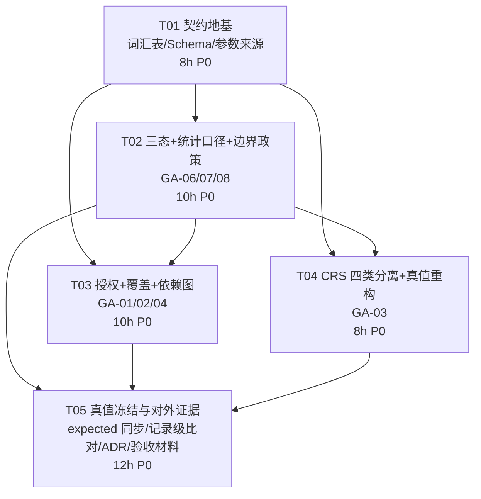

# Stage 0 重验：任务分解

- 版本：v1.0（2026-10-26）｜作者：高见远（架构师）
- 契约依据：`docs/stage0-recheck-contract.md`（**先读契约，再动手**）
- 排序：按实现顺序；依赖关系见 §6
- 约束：零第三方依赖；不提交 git；不修改 `tools/` 以外不该动的实现（expected 的修改集中在 T05，附理由）
- 工作量口径：单人串行、含自测与写文档；不含等待确认的时间

## 0. 全局约定（五个任务共同遵守）

1. 每个任务都必须同时交付**实现 + 对应反例用例（`tools/recheck_probes.py` 中的 case）+ 文档同步**。
2. 每个 GA 编号至少绑定一个可运行用例，用例的**期望值先手写**，再跑实现。
3. 任何"未实现"必须落成 `REJECTED` / `NOT_IMPLEMENTED` / `INDETERMINATE`，禁止静默降级。
4. 不变式（I1–I6、组合矩阵、依赖传播矩阵）用断言写进代码，违反即失败。
5. 反例回归输出统一写到 `work/stage0-recheck/independent-probes.json`，供 QA 与验收方对拍。

---

## T01　契约地基：词汇表 / Schema 一致性 / 结构化参数来源

**目标**：把"能判 FAIL 的证据"这件事做成机器可校验的结构。本任务**不改变任何判定语义**（不触碰 R01–R10 的判定逻辑），因此风险最低，先做。

**优先级**：P0　**前置依赖**：无　**工作量估计**：8 h

### 涉及文件

| 文件 | 动作 | 说明 |
|---|---|---|
| `tools/stage0_gate.py` | 修改 | 新增模块常量 `VERDICTS / EXECUTION_STATUSES / LEGAL_COMBOS / REASON_CODES`；新增 `verify_document_hashes()`；用 `verify_parameter_sources()` 替换 `verify_threshold_sources()`（`str in quote` 一律删除）；`load_yaml/_block` 把空序列归一为 `[]`（不得为 `None`）；`SCHEMA_VERSION` 升为 `stage0-2` |
| `tools/check_schema_consistency.py` | **新增** | 标准库实现的 Schema 子集校验器（支持 `type/enum/required/properties/items/minItems/maxItems/minimum/maximum/pattern/additionalProperties:false`；遇到不支持的关键字输出 `UNSUPPORTED_KEYWORD` 警告并**显式列出**，不得静默跳过视为通过） |
| `tools/make_examples.py` | 修改 | `dump_yaml` 空列表写 `[]`；`RULE_MAP` 为 R07 增加 `expected_crs`，为 R09/R10/R06/R07 增加 `parameter_sources`；新增 R02 的 `missing_rate_policy: "STRICT"` |
| `tools/recheck_probes.py` | **新增**（建骨架 + T01 用例） | 独立反例回归脚本：内存变异 + expected 手写 + 输出 JSON |
| `schemas/parameter_source.schema.json` | **新增** | 契约 §6.1 的结构定义 |
| `schemas/rule.schema.json` | 修改 | 按 rule_type 补十类 `parameters` 约束；`preconditions` 类型收紧为 array 且允许空；新增 `parameter_sources` 数组约束 |
| `schemas/check_result.schema.json` | 修改 | `execution_status` 增加 `NOT_IMPLEMENTED / REJECTED / FAILED`；`summary_counts` 补齐 §7.1 七个字段与必填约束；新增 `risk_signals` |
| `schemas/requirement.schema.json` | 修改 | 新增 `interpretation` 字段（ISO8601 子集说明等） |
| `schemas/finding.schema.json` | 修改 | 补齐 `reason_code` 取值清单（含本轮新增码） |
| `examples/*/approved-rules.yaml`（5 个包） | 修改 | 补 `parameter_sources`、R07 的 `expected_crs`、R02 的 `missing_rate_policy`；`preconditions` 空值写 `[]` |
| `examples/INPUT_MANIFEST.json` | 修改 | 重算哈希（由 `make_examples.py` 生成，不手改） |
| `docs/stage0-recheck-contract.md` | 只读参考 | — |

### 验收判据

| GA | 反例 / 检查 | 期望 |
|---|---|---|
| GA-05 | `max_age_days: 30 → 3` | `verify_parameter_sources()` 返回非空（token 边界匹配，"3" 不出现在 "30" 中）；门禁 `[REJECT]` |
| GA-05 | 条款 `document_sha256` 改为 64 个 `0` | `verify_document_hashes()` 报 `DOCUMENT_HASH_MISMATCH` |
| GA-09 | `python tools/check_schema_consistency.py` 对全部样例 | 0 不一致；`preconditions` 无 `null`，空依赖为 `[]` |
| GA-09 | 十类规则各造一个缺参数样例 | 均被 Schema 子集校验拦下 |
| 契约 §1.3 | 构造 `PASS + PARTIAL`、`FAIL + BLOCKED` | 断言抛错 |

### 完成标准

- `python tools/check_schema_consistency.py` 退出码 0 且报告"支持关键字子集 + 未支持关键字清单"。
- T01 用例在 `tools/recheck_probes.py` 中全部按手写预期通过。
- 五个包仍能跑通（结论允许与旧 expected 不同，T05 统一同步；T01 结束后若门禁 `[DIFF]` 属**已知待同步**，需在 `work/stage0-recheck/` 留记录说明）。

---

## T02　三态统一 + 统计口径 + 边界政策

**目标**：先统一"能输出什么"，后续任务才有正确的词汇可用。

**优先级**：P0　**前置依赖**：T01　**工作量估计**：10 h

### 涉及文件

| 文件 | 动作 | 说明 |
|---|---|---|
| `tools/stage0_gate.py` | 修改 | ① `verdict` 收敛为三态，`UNKNOWN` 全部消除；`selfResult()` 增加组合合法性断言；新增 `NOT_IMPLEMENTED / REJECTED / FAILED` 分支；② `summary_counts` 改为七字段并实现 I1–I6 断言；③ **候选不计失败**：`duplicate_candidate` 的涉及行进 `records_indeterminate`，不进 `records_failed`，不传播阻断；④ 重写 `point_in_ring` 为"先判边界再射线法"，修复 exclusive 不对称；⑤ R08 读取 `boundary_policy`，未知/缓冲配置 → `config_rejections` |
| `tools/recheck_probes.py` | 修改 | 增加 GA-06/07/08 用例 |
| `docs/three-state-verdict.md` | 修改 | 组合矩阵按契约 §1.3 收紧（删除 FAIL+NOT_EXECUTED 合法格）；新增"统计口径"章节 |
| `docs/rule-semantics.md` | 修改 | R02 缺失率政策（§9.2）；R08 边界政策语义（§8）；R10 候选不计失败（§7.2）；R03 的 ISO8601 改为"本项目子集"表述 |
| `docs/limitations.md` | 修改 | 边界政策的 Stage 0 限制；ISO8601 子集；量级仅作信号（CRS 部分由 T04 补） |
| `examples/*/expected/aggregate.json` | **不改**（集中在 T05） | 本任务结束后门禁会报 `[DIFF]`，属预期 |

### 验收判据

| GA | 反例 / 检查 | 期望 |
|---|---|---|
| GA-06 | `blocked` 包 R06/R08/R10 | `verdict == "INDETERMINATE"`、`execution_status == "BLOCKED"`；全库无 `UNKNOWN` 字样 |
| GA-07 | clean 包 R10 | `records_total=12, records_evaluated=12, records_failed=0, records_indeterminate=2, records_skipped_upstream=0, records_uninterpretable=0, findings=1` |
| GA-08 | `point_in_ring_or_boundary` 单位正方形四边中点 | `exclusive` 全 `false`；`inclusive` 全 `true` |
| GA-08 | R08 配置 `boundary_policy: "exclusive"` | 按 exclusive 执行（不得固定 inclusive）；配 `"unknown_policy"` 或 `buffer_m` → `config_rejections` |
| 契约 §1.3 | 非法组合注入 | 断言失败并登记 `FAILED` |

### 完成标准

- 全库 `grep -r "UNKNOWN"` 在 `tools/` 与 `schemas/` 中为空（注释与文档中的历史说明除外）。
- I1–I6 断言在五个包上全部成立。

---

## T03　授权 / 覆盖 / 依赖图

**目标**：让"缺规则不放行、规则不能降级条款、未知依赖不忽略"成为执行前的硬校验。

**优先级**：P0　**前置依赖**：T01、T02　**工作量估计**：10 h

### 涉及文件

| 文件 | 动作 | 说明 |
|---|---|---|
| `tools/stage0_gate.py` | 修改 | ① 新增 `validate_configuration()`：重复 `rule_id` / 重复 `requirement_id` / 未知 `requirement_ids` / `preconditions` 未知 ID / 有环 / 自依赖 / 重复 precondition；② 新增 `build_clause_coverage()`：以必检条款全集 U 逐条判定覆盖状态（契约 §3.2）；③ 新增 `resolve_required_for_release()`：按 §2.2 派生、按 §2.3 冲突即 `REJECTED`；④ 重写 `aggregate(clause_coverage, config_rejections, n_rows)`（契约 §3.4）；⑤ `ordered_rules()` 删除"过滤未知依赖"的写法；⑥ 依赖状态传播矩阵（§5.2） |
| `tools/stage0_gate.py` | 修改 | `config_rejections` 非空时：门禁打印 `[REJECT]`、退出码 1（即使与 expected 一致） |
| `tools/recheck_probes.py` | 修改 | 增加 GA-01/02/04 用例 |
| `docs/three-state-verdict.md` | 修改 | 聚合章节改为"条款全集覆盖 + 条款级聚合"；删除旧"按规则聚合"伪代码 |

### 验收判据（逐条对应验收方探针）

| GA | 反例 | 期望 |
|---|---|---|
| GA-01 | clean 删除 R09（保留必检且 SUPPORTED 的 C1） | 总体 `INDETERMINATE`；`clause_coverage` 中 C1 `coverage_state=UNMAPPED`、`reason=CLAUSE_NOT_COVERED_BY_RULE`；门禁非 0 |
| GA-02 | clean 的 R09 `required_for_release: true → false` + 注入一条过期记录 | `config_rejections` 含 `CLAUSE_POLICY_DOWNGRADED_BY_RULE`；总体 `INDETERMINATE`；门禁 `[REJECT]` 非 0 |
| GA-04 | clean 的 R01 `preconditions` 加 `NONEXISTENT_RULE` | `config_rejections` 含 `UNKNOWN_PRECONDITION`；门禁非 0（不得再静默过滤） |
| GA-04 | 构造 R02↔R03 循环依赖 | `config_rejections` 含 `CYCLIC_DEPENDENCY`，拒绝执行（不得"记 errors 后继续"） |
| GA-04 | 复制一份 R05（重复 ID） | `config_rejections` 含 `DUPLICATE_RULE_ID` |
| 契约 §5.2 | 上游 `NOT_APPROVED` / `NOT_IMPLEMENTED` 的下游 | 下游 `INDETERMINATE / BLOCKED`，**不得** PASS |

### 完成标准

- 上述 6 个反例全部按手写预期通过；原探针脚本 `stage0_independent_probes.py` 在这 6 项上不再产出 `PASS`。
- 五个包的 `clause_coverage` 覆盖 U 中每一条，无遗漏。

---

## T04　CRS 四类判定分离 + 真值重构 + 新反例

**目标**：把量级猜测从判定里彻底移除，改用可证明的声明冲突。

**优先级**：P0　**前置依赖**：T01、T02（不强依赖 T03，可在 T03 后并行）　**工作量估计**：8 h

### 涉及文件

| 文件 | 动作 | 说明 |
|---|---|---|
| `tools/stage0_gate.py` | 修改 | 重写 `rule_crs_declaration`：按契约 §4 分为 C1/C2/C3/C4 四类；删除 `degree_like` 驱动 FAIL 的代码路径；量级只写 `risk_signals.CRS_MAGNITUDE_RISK`（message 必须含"合法小值投影坐标也可能落在该量级"）；`normalize()` 严格规范比（不允许别名映射）；C1/C2 非 PASS 时下游空间规则 `BLOCKED`（`CRS_NOT_RESOLVED`） |
| `examples/blocked/crs.json` | 修改 | 数据不变（`EPSG:3857`/metre），`note` 改为"用于演示：原文要求 EPSG:4326 与提交声明 EPSG:3857 的可证明冲突" |
| `examples/blocked/expected/aggregate.json` | 修改（**理由见 T05 登记表**） | R07 `FAIL` 原因码改为 `CRS_DECLARATION_MISMATCH`；R06/R08/R10 `UNKNOWN → INDETERMINATE`；真值依据 note 改写 |
| `examples/crs_same_unit_wrong/` | **新增整包**（8 文件：delivery_spec.md / dictionary.csv / poi.csv / area.geojson / crs.json / requirements.yaml / approved-rules.yaml / expected/aggregate.json） | `crs.json` 声明 `EPSG:4490`/`degree`；原文 B2 要求 `EPSG:4326`；期望 R07 `FAIL / CRS_DECLARATION_MISMATCH`，R06/R08/R10 `INDETERMINATE / BLOCKED`，总体 `FAIL`。expected **人工手写**，不经过 `make_examples.py` |
| `tools/recheck_probes.py` | 修改 | 增加 `unexpected_crs_with_degree_unit`（EPSG:4490 → FAIL）、`missing_crs_declaration`（→ INDETERMINATE，非 FAIL）、`crs_projected_small_values_legit`（小值米坐标 → 不得因量级判 FAIL） |
| `docs/rule-semantics.md` | 修改 | R07 语义按四类重写；删除"声明单位与坐标量级一致"作为 PASS 条件 |
| `docs/limitations.md` | 修改 | C4 真实性不可证；C3 量级只作信号 |
| `examples/README.md` | 修改 | `blocked` 真值说明改为"声明冲突"；新增 `crs_same_unit_wrong` 包说明 |

### 验收判据

| GA | 反例 | 期望 |
|---|---|---|
| GA-03 | clean 声明改 `EPSG:4490`（单位仍 degree） | R07 `FAIL / CRS_DECLARATION_MISMATCH`，总体非 PASS（修掉探针的 `PASS` 漏报） |
| GA-03 | clean 移除 `declared_crs` | 总体 `INDETERMINATE`（**不是** FAIL）；R06/R08/R10 `INDETERMINATE / BLOCKED` |
| GA-03 | 声明 `EPSG:3857`/metre + 坐标取原点附近小值（如 116.3/39.9 米） | R07 **不得**因量级判 FAIL；仅产出 `CRS_MAGNITUDE_RISK` 信号 |
| GA-03 | `blocked` 包 | 结论仍 `FAIL`，但 finding 的 evidence 必须含 `expected_crs/declared_crs/requirement_id/source_line_start/source_quote`，不得出现 `degree_like_records` 作为判定理由 |

### 完成标准

- `blocked` 包结论未放松（仍 FAIL），真值依据已换成可证明冲突。
- 新增包 `crs_same_unit_wrong` 的 expected 为人工推导，`examples/TRUTH_REVIEW.md` 有对应条目。

---

## T05　真值冻结与对外证据：expected 同步 + 记录级比对 + 文档 / ADR / 验收材料

**目标**：把"凭什么说这个 expected 是对的"和"对外怎么交代"做实。**这是唯一允许动 expected 的任务**（T04 中 blocked 的一处已在下表中登记并由本任务复核）。

**优先级**：P0　**前置依赖**：T02、T03、T04　**工作量估计**：12 h

### 涉及文件

| 文件 | 动作 | 说明 |
|---|---|---|
| `examples/*/expected/aggregate.json`（clean / defective / corrected / ambiguous / blocked / crs_same_unit_wrong） | 修改（**独立任务，理由见下表**） | `UNKNOWN → INDETERMINATE`；`per_rule` 升级为记录级对象（§9.4）；新增 `schema_version / truth_source / truth_review` |
| `examples/TRUTH_REVIEW.md` | **新增** | 逐包人工推导过程 + 本轮差异清单 + 推导人/日期/依据 |
| `examples/README.md` | 修改 | 真值表与可靠性说明同步；明确"重生成不等于真值证明" |
| `tools/stage0_gate.py` | 修改 | `compare_expected()` 升级为记录级比对（verdict / execution_status / reason_codes / hit_lines / summary_counts） |
| `tools/selfcheck_guards.py` | 修改 | C 项改名「产物 mode 一致性检查」；新增 C2 真负面（注入 `mode=live` 必须被拦）；新增 E/F/G 三项（缺声明不得 FAIL、候选不得计失败、未知依赖必须被拒） |
| `docs/adr/ADR-006-budget-knob-routing.md` | 修改 | GA-10：降级为"未来实验"，移出 Stage 2 必做；保留预算上限与成本记录；加入"模型自报置信度不得作为批准依据"约束 |
| `docs/adr/ADR-010-stage0-recheck-contract.md` | **新增** | 记录本轮关键决策与"为什么不这么做"的备选方案 |
| `docs/adr/README.md` | 修改 | 索引加入 ADR-010；ADR-006 状态改为"未来实验（不在 Stage 2 必做范围）" |
| `docs/architecture.md` | 修改 | 架构图移除/降级"模型网关 + 预算旋钮 θ"为未来实验标注 |
| `docs/data-model.md` | 修改 | CheckResult 新状态与统计口径；新增 ParameterSource 对象 |
| `docs/three-state-verdict.md` | 修改 | 最终与契约对齐（若 T02/T03 已改，本任务复核一致性） |
| `docs/stage0-recheck-contract.md` | 复核 | 若实现与契约有偏差，**改契约或改实现**，不得两边不一致 |
| `acceptance/stage-0/RETRACTED.md` | **新增** | 撤回原 `OPEN_ISSUES.md` 的"P1 = 0"结论，注明本轮独立审查发现的 5 项 P1 |
| `work/stage0-recheck/` | **新增产物** | `independent-probes.json`、`schema-consistency.json`、`deps-smoke.txt`、`commands.md`（实际执行的命令与输出） |
| `acceptance/stage-0-recheck/` | 配合 QA 提供原料 | HANDOFF / 实际命令与结果 / 开放问题 / 独立反例逐项结果 / Schema 一致性结果 / 目标依赖冒烟 —— **由 QA 主导组装，工程师提供上述 `work/` 原料与文档** |

### expected 修改登记表（逐条理由，缺一条即不得修改）

| 包 | 修改内容 | 理由 | 是否放松结论 |
|---|---|---|---|
| blocked | `UNKNOWN → INDETERMINATE`（R06/R08/R10） | 契约词汇表废止 `UNKNOWN`（GA-06） | 否，仍为不可放行 |
| blocked | R07 原因码改 `CRS_DECLARATION_MISMATCH`，真值依据改"声明冲突" | GA-03：原依据（量级猜测）被判定为知识性错误 | 否，仍 FAIL |
| ambiguous | D1/D2 `UNKNOWN → INDETERMINATE` | 同上 | 否 |
| 全部 6 包 | `per_rule` 由 `[verdict, count]` 升级为记录级对象 | GA/验收方：数量比对不足以证明命中正确（§9.4） | 否，比对更严 |
| 全部 6 包 | 新增 `schema_version / truth_source / truth_review` | 验收方：保留人工真值审核记录 | 否 |
| clean | R10 `records_evaluated 11 → 12`、`records_indeterminate 2` | GA-07：候选不是失败阻断 | 否 |

**任何超出上表的 expected 改动都视为违规**，必须先回到契约确认。

### 验收判据

| 项 | 判据 |
|---|---|
| GA-06/07 | 六个包的 expected 全部通过记录级比对，退出码 0 |
| 自检证据限制 | `selfcheck_guards.py` 输出 7 项（A/B/C/C2/D/E/F/G）全 PASS；C2 为**真注入负面**路径 |
| GA-10 | `ADR-006` 状态为"未来实验"、不含"Stage 2 必做"字样、含"自报置信度不得用于批准"约束；`ADR-010` 存在且含备选方案 |
| 验收交付 | `acceptance/stage-0-recheck/` 六项内容齐备；`acceptance/stage-0/` 保留且含 `RETRACTED.md` |
| 阶段缺口 | 目标依赖安装/运行验证与 Docker 冒烟作为**阶段缺口**写明，不得声称已完成 |
| 红线 | `git diff --stat examples/*/expected/` 的每一处改动都能在 `TRUTH_REVIEW.md` 找到对应条目 |

### 完成标准

- `python tools/stage0_gate.py` 退出码 0（六包全绿，且全绿来自"实现符合人工真值"，不是来自改 expected）。
- `python tools/selfcheck_guards.py` 退出码 0。
- `python tools/recheck_probes.py` 全部 case 与手写预期一致，并输出 `work/stage0-recheck/independent-probes.json`。
- `python tools/check_schema_consistency.py` 退出码 0。
- `python tools/smoke_deps.py` 输出已存档到 `work/stage0-recheck/deps-smoke.txt`。

---

## 6. 任务依赖图

并行建议：T03 与 T04 在 T02 完成后可并行（两者都改 `stage0_gate.py`，需约定改动区域：T03 集中在 `validate_configuration / build_clause_coverage / aggregate / ordered_rules`，T04 集中在 `rule_crs_declaration`）。若只有一人串行，按 T01→T02→T03→T04→T05 执行。

## 7. 工作量汇总

| 任务 | 估计 | 覆盖 GA |
|---|---|---|
| T01 | 8 h | GA-05、GA-09 |
| T02 | 10 h | GA-06、GA-07、GA-08 |
| T03 | 10 h | GA-01、GA-02、GA-04 |
| T04 | 8 h | GA-03 |
| T05 | 12 h | GA-10 + 自检证据限制 6 条 + 验收材料 |
| **合计** | **48 h**（约 6 个工作日，浮动 ±20%） | GA-01 ~ GA-10 全覆盖 |

## 7.5 契约勘误带来的两条追加项（2026-10-26）

1. **`reason_code` 不变式 I7–I9 对规则级同样适用**：`OK` 只在 PASS 时合法。当前规则级在"部分记录被阻断且无 finding"、
   以及"仅候选 finding"两种情形下仍会输出 `INDETERMINATE + OK`（clean 的 R10 属后者）。
   修条款级时必须一并修规则级，否则「FAIL / INDETERMINATE：OK」只是从条款级挪到了规则级。
2. **遗留至 Stage 1**：`coverage_state` 六态中 `UNAPPROVED / NO_IMPLEMENTATION / MISSING_RESULT / CONFIG_REJECTED`
   四态无示例包级正例（`CONFIG_REJECTED` 仅被探针间接覆盖，且探针只断言 `config_rejections` 的码、未断言 `coverage_state`）。
   Stage 1 需补反例包或探针使六态全部有可执行正例；在此之前验收材料须写明该覆盖缺口，不得声称覆盖模型已完整验证。

## 8. 交给 QA 的验收判据清单（任务全部完成后的检查项）

1. 五个 P1 反例（GA-01~GA-05）在 `tools/recheck_probes.py` 中逐项通过，且**原独立探针脚本 `stage0_independent_probes.py` 的对应项不再产出 `PASS`**。
2. 全库无 `UNKNOWN` verdict；`schemas/check_result.schema.json` 枚举与实际产出一致。
3. clean 包 R10 统计口径符合 §7.2 表格。
4. `blocked` 包结论仍为 `FAIL`，且 finding evidence 不含量级理由。
5. `missing_crs_declaration` 总体为 `INDETERMINATE`（非 FAIL）。
6. 六个包 expected 的每一处 diff 都能在 `examples/TRUTH_REVIEW.md` 找到条目。
7. `check_schema_consistency.py` 与 `selfcheck_guards.py`（含 C2 真负面）退出码均为 0。
8. `acceptance/stage-0-recheck/` 六项内容齐备；`acceptance/stage-0/RETRACTED.md` 已撤回"P1=0"。
9. 目标依赖与 Docker 冒烟作为阶段缺口记录，未声称完成。
10. 无任何第三方依赖 import（`grep -rE "^\s*(import|from)\s+(geopandas|shapely|pyproj|pydantic|jsonschema|pandas|pytest)"` 为空）。
